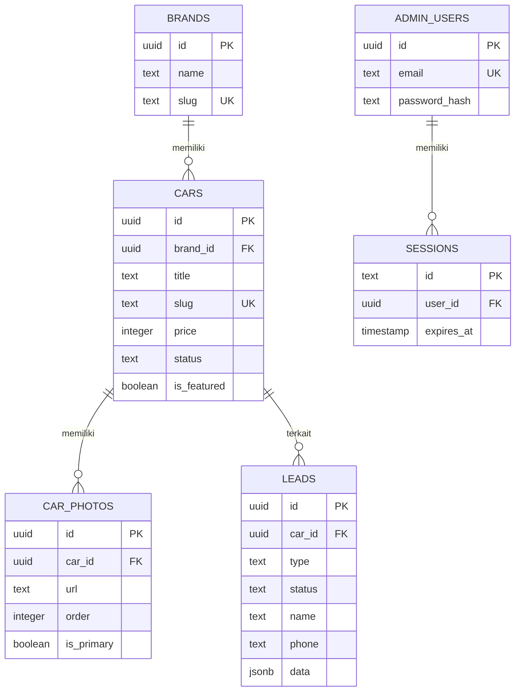

# Dokumentasi Model Data (Database Schema)

Database menggunakan **PostgreSQL 15** dengan **Drizzle ORM** (`drizzle-orm/bun-sql`).

---

## 1. Tabel & Relasi

### `brands`

Menyimpan daftar merek kendaraan yang tersedia di showroom.

- `id` (UUID, Primary Key, default random)
- `name` (TEXT, NOT NULL, UNIQUE) — Contoh: "Toyota", "Honda"
- `slug` (TEXT, NOT NULL, UNIQUE, Indexed) — Contoh: "toyota", "honda"
- `logo_url` (TEXT, Nullable)
- `created_at` (TIMESTAMP, NOT NULL, default now())

### `cars`

Entitas utama listing mobil bekas.

- `id` (UUID, Primary Key, default random)
- `brand_id` (UUID, NOT NULL, FK -> `brands.id`, ON DELETE RESTRICT)
- `title` (TEXT, NOT NULL) — Judul listing, contoh: "Toyota Avanza 1.3 G Manual 2020"
- `slug` (TEXT, NOT NULL, UNIQUE, Indexed) — URL-friendly slug unik
- `model` (TEXT, NOT NULL) — Contoh: "Avanza 1.3 G"
- `year` (INTEGER, NOT NULL) — Tahun pembuatan kendaraan (Indexed)
- `price` (BIGINT, NOT NULL) — Harga mobil dalam rupiah (Indexed)
- `transmission` (TEXT, NOT NULL) — Pilihan: `'manual'` | `'matic'`
- `mileage` (INTEGER, NOT NULL) — Jarak tempuh dalam kilometer
- `fuel_type` (TEXT, NOT NULL, default `'bensin'`) — Pilihan: `'bensin'` | `'diesel'` | `'hybrid'` | `'listrik'`
- `engine_capacity` (INTEGER, Nullable) — Kapasitas mesin dalam cc
- `color` (TEXT, Nullable) — Warna bodi kendaraan
- `license_plate` (TEXT, Nullable) — Plat nomor kendaraan (misal: "B 1234 ABC")
- `stnk_valid_until` (TIMESTAMP, Nullable) — Masa berlaku pajak / STNK
- `description` (TEXT, Nullable) — Deskripsi kondisi unit
- `features` (JSONB, default `[]`) — Array string daftar fitur (misal: AC Double Blower, Sunroof)
- `status` (TEXT, NOT NULL, default `'tersedia'`, Indexed) — `'draft'` | `'tersedia'` | `'booking'` | `'terjual'`
- `is_featured` (BOOLEAN, NOT NULL, default `false`, Indexed) — Flag mobil unggulan di beranda
- `views_count` (INTEGER, NOT NULL, default `0`) — Jumlah penayangan
- `created_at` (TIMESTAMP, NOT NULL, default now())
- `updated_at` (TIMESTAMP, NOT NULL, default now())

### `car_photos`

Foto-foto kendaraan.

- `id` (UUID, Primary Key, default random)
- `car_id` (UUID, NOT NULL, FK -> `cars.id`, ON DELETE CASCADE, Indexed)
- `url` (TEXT, NOT NULL) — URL / path penyimpanan foto
- `order` (INTEGER, NOT NULL, default `0`, Indexed) — Urutan tampilan foto
- `is_primary` (BOOLEAN, NOT NULL, default `false`) — Flag foto utama/cover
- `created_at` (TIMESTAMP, NOT NULL, default now())

### `promos`

Banner promo atau penawaran kredit/diskon showroom.

- `id` (UUID, Primary Key, default random)
- `title` (TEXT, NOT NULL)
- `slug` (TEXT, NOT NULL, UNIQUE, Indexed)
- `description` (TEXT, Nullable)
- `banner_url` (TEXT, Nullable)
- `start_date` (TIMESTAMP, Nullable)
- `end_date` (TIMESTAMP, Nullable)
- `is_active` (BOOLEAN, NOT NULL, default `true`, Indexed)
- `created_at` (TIMESTAMP, NOT NULL, default now())

### `testimonials`

Testimoni dan galeri serah terima unit ke pelanggan.

- `id` (UUID, Primary Key, default random)
- `customer_name` (TEXT, NOT NULL)
- `location` (TEXT, Nullable) — Kota asal pembeli (misal: "Jakarta Barat")
- `car_name` (TEXT, Nullable) — Unit yang dibeli (misal: "Toyota Avanza 2020")
- `photo_url` (TEXT, Nullable)
- `quote` (TEXT, NOT NULL)
- `rating` (INTEGER, NOT NULL, default `5`)
- `is_displayed` (BOOLEAN, NOT NULL, default `true`, Indexed)
- `created_at` (TIMESTAMP, NOT NULL, default now())

### `articles`

Artikel edukasi dan tips otomotif untuk SEO.

- `id` (UUID, Primary Key, default random)
- `title` (TEXT, NOT NULL)
- `slug` (TEXT, NOT NULL, UNIQUE, Indexed)
- `content` (TEXT, NOT NULL) — Konten artikel (Markdown / HTML)
- `cover_image_url` (TEXT, Nullable)
- `status` (TEXT, NOT NULL, default `'draft'`, Indexed) — `'draft'` | `'terbit'`
- `published_at` (TIMESTAMP, Nullable)
- `created_at` (TIMESTAMP, NOT NULL, default now())
- `updated_at` (TIMESTAMP, NOT NULL, default now())

### `leads`

Permintaan pelanggan yang masuk melalui website.

- `id` (UUID, Primary Key, default random)
- `car_id` (UUID, Nullable, FK -> `cars.id`, ON DELETE SET NULL)
- `type` (TEXT, NOT NULL, Indexed) — `'tukar_tambah'` | `'test_drive'` | `'kontak'` | `'simulasi'`
- `status` (TEXT, NOT NULL, default `'baru'`, Indexed) — `'baru'` | `'dihubungi'` | `'selesai'`
- `name` (TEXT, NOT NULL) — Nama pengirim
- `phone` (TEXT, NOT NULL) — Nomor WhatsApp
- `notes` (TEXT, Nullable)
- `data` (JSONB, default `{}`) — Detail spesifik per tipe form (misal data mobil lama pada tukar tambah, tenor/DP pada simulasi)
- `created_at` (TIMESTAMP, NOT NULL, default now(), Indexed)
- `updated_at` (TIMESTAMP, NOT NULL, default now())

### `site_settings`

Pengaturan informasi showroom dan parameter pembiayaan.

- `id` (TEXT, Primary Key, default `'default'`)
- `showroom_name` (TEXT, NOT NULL, default `'Bintang Mobil'`)
- `whatsapp_number` (TEXT, NOT NULL, default `'6281298765432'`)
- `phone_number` (TEXT, Nullable)
- `address` (TEXT, NOT NULL)
- `maps_url` (TEXT, Nullable)
- `opening_hours` (TEXT, Nullable)
- `default_interest_rate` (NUMERIC(4,2), NOT NULL, default `8.50`)
- `min_down_payment_percent` (NUMERIC(4,2), NOT NULL, default `20.00`)
- `updated_at` (TIMESTAMP, NOT NULL, default now())

### `admin_users`

Akun administrator backoffice.

- `id` (UUID, Primary Key, default random)
- `name` (TEXT, NOT NULL)
- `email` (TEXT, NOT NULL, UNIQUE, Indexed)
- `password_hash` (TEXT, NOT NULL) — Hash password menggunakan Bun Native Password (Argon2id)
- `created_at` (TIMESTAMP, NOT NULL, default now())

### `sessions`

Sesi login admin berbasis token.

- `id` (TEXT, Primary Key) — Token sesi acak
- `user_id` (UUID, NOT NULL, FK -> `admin_users.id`, ON DELETE CASCADE, Indexed)
- `expires_at` (TIMESTAMP, NOT NULL, Indexed)
- `created_at` (TIMESTAMP, NOT NULL, default now())

---

## 2. Diagram Hubungan Entitas (ERD)



---

## 3. Seed Data

Perintah seed idempoten:

```bash
bun run db:seed
```

Data yang diisikan:

1. Akun admin default: `admin@bintangmobil.com` (password: `Admin123!`).
2. Pengaturan showroom default (`Bintang Mobil`, WhatsApp, alamat, suku bunga 8.5%).
3. Merek umum: Toyota, Honda, Daihatsu, Mitsubishi, Suzuki, Nissan, Hyundai, Mazda.
4. 10 data listing mobil contoh lengkap dengan foto cover, spesifikasi, dan status stok.
5. 3 testimoni pelanggan dari mockup.
6. 1 promo aktif dan 2 artikel tips mobil bekas.
